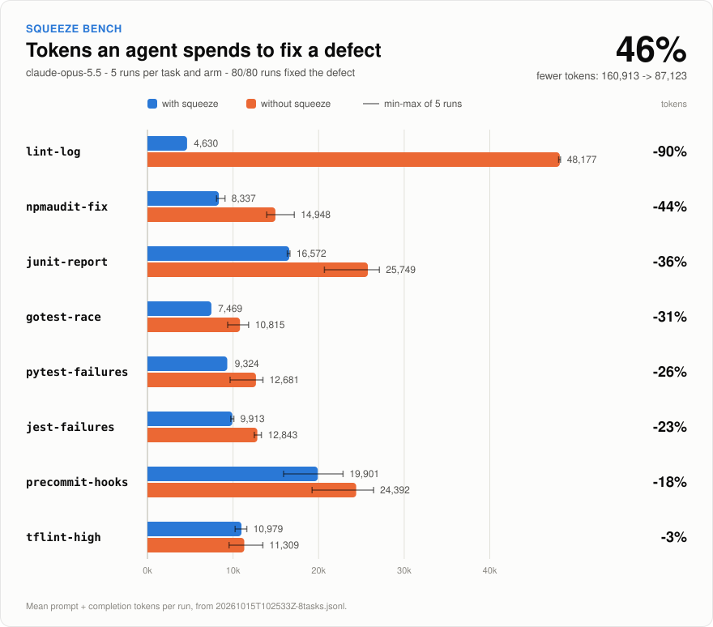

# Bench results

Model: `claude-opus-5-5`. Each task was solved 5 times without squeeze (control) and 5 times with squeeze. All 120 runs fixed the defect. Tokens are the mean per run.

`just chart bench/results/<file>.jsonl` redraws `results.svg` from a run; the lines on each bar span the fewest and most tokens of the 5 runs.
